<p align="center">
  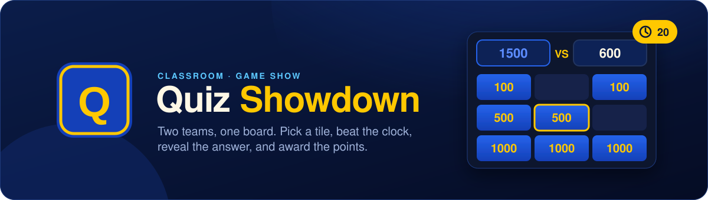
</p>

<h1 align="center">Quiz Showdown</h1>

<p align="center">A two-team, Jeopardy-style quiz game for the classroom. Pick a tile, beat the clock, reveal the answer, and award the points, all from one laptop on the projector.</p>

<p align="center"><code>React 18</code> &nbsp; <code>Vite 5</code> &nbsp; <code>TypeScript</code> &nbsp; <code>Tailwind CSS</code> &nbsp; <code>Runs on localhost</code></p>

<p align="center">
  <a href="#run-it-locally"></a>
  <br>
  <sub>Two commands to start: <code>npm install</code> then <code>npm run dev</code>. No account or server needed.</sub>
</p>

<p align="center">
  <a href="#at-a-glance"><strong>At a glance</strong></a> &nbsp;·&nbsp;
  <a href="#game-tour"><strong>Game tour</strong></a> &nbsp;·&nbsp;
  <a href="#how-it-works"><strong>How it works</strong></a> &nbsp;·&nbsp;
  <a href="#run-it-locally"><strong>Run it locally</strong></a> &nbsp;·&nbsp;
  <a href="#hosting-the-game"><strong>Hosting guide</strong></a> &nbsp;·&nbsp;
  <a href="#edit-the-questions"><strong>Edit the questions</strong></a>
</p>

The board has six categories and three point values (100, 500, 1000), for 18 questions in all. The included set covers art criticism and visual storytelling: formalism, contextualism, structuralism, semiotics, and visual narratives. Everything runs in the browser. Scores and board progress are saved on the machine running the game, so a refresh or an accidental tab close doesn't end it.

## At a glance

<table>
  <tr>
    <td align="center" width="25%"><strong>01 · Board</strong><br><sub>Six categories, three point values, played tiles grey out</sub></td>
    <td align="center" width="25%"><strong>02 · Timer</strong><br><sub>10–60 s presets or custom, pause, +10 s</sub></td>
    <td align="center" width="25%"><strong>03 · Scoring</strong><br><sub>Winner gains the points, the other team loses them</sub></td>
    <td align="center" width="25%"><strong>04 · Host tools</strong><br><sub>Undo, autosave, mute, keyboard shortcuts</sub></td>
  </tr>
</table>

Sound effects are generated in the browser, so there are no audio files to load. A leading team gets a crown, and a team that answers correctly twice in a row shows a streak. When the last tile is scored, a final screen announces the winner.

## Game tour

These are **PNGs captured from the local dev server in headless Microsoft Edge** at 1280 × 860 on November 22, 2026. The phone view is 390 × 844 at 2× and is cropped to the board. Scores in the mid-game shots were set up for the capture. Select any image to open it at full size.

<table>
  <tr>
    <td align="center"><a href="docs/quiz-showdown.png">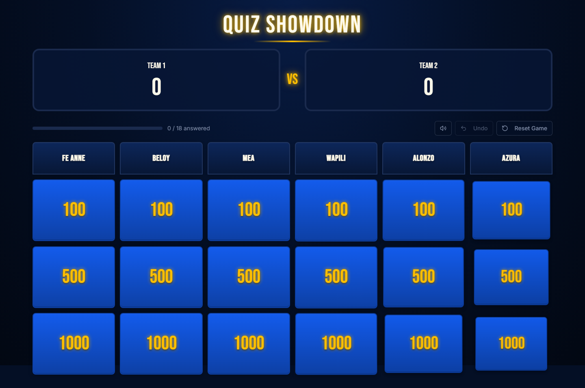</a><br><strong>1 · New game</strong><br><sub>All 18 tiles open</sub></td>
    <td align="center"><a href="docs/screenshots/01-board.png">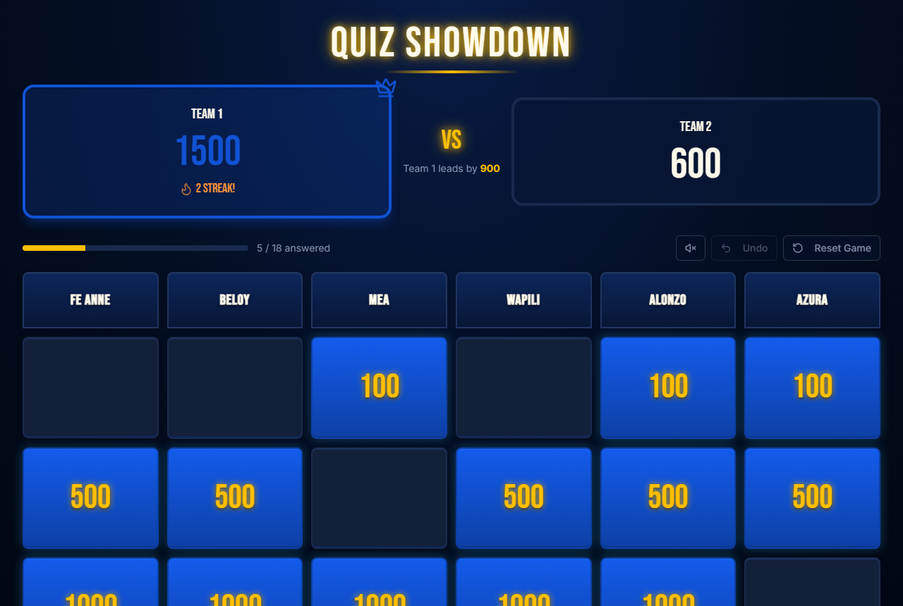</a><br><strong>2 · Mid-game</strong><br><sub>Crown, streak, and lead</sub></td>
    <td align="center"><a href="docs/screenshots/02-timer-setup.png">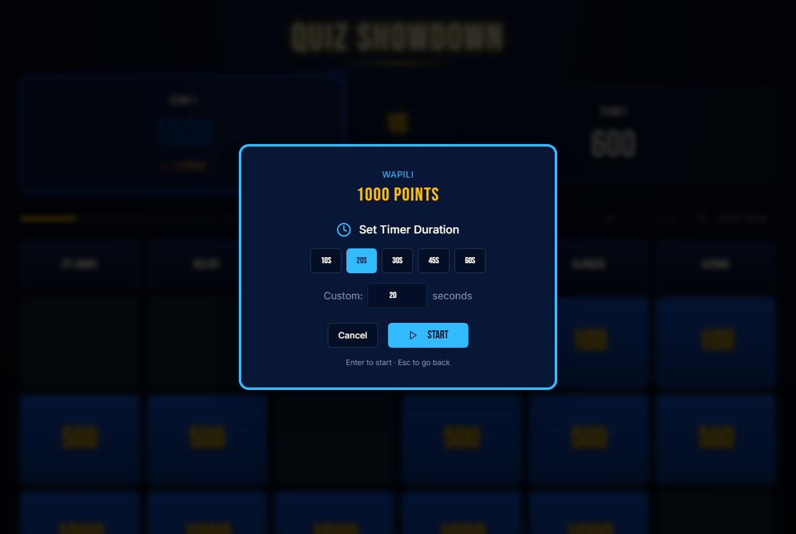</a><br><strong>3 · Timer setup</strong><br><sub>Choose the time limit</sub></td>
  </tr>
  <tr>
    <td align="center"><a href="docs/screenshots/03-question.png">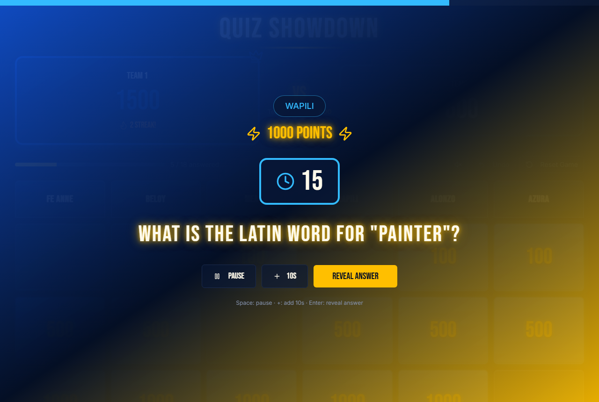</a><br><strong>4 · Question</strong><br><sub>Countdown with pause and +10 s</sub></td>
    <td align="center"><a href="docs/screenshots/04-answer.png">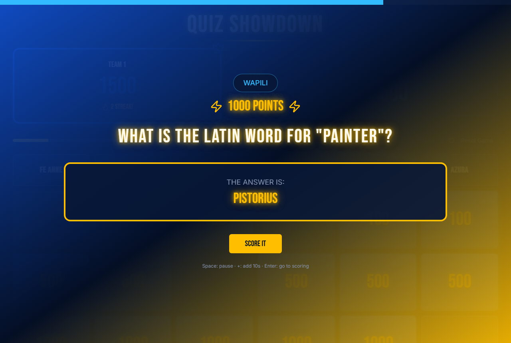</a><br><strong>5 · Answer</strong><br><sub>Revealed early or at time up</sub></td>
    <td align="center"><a href="docs/screenshots/05-scoring.png">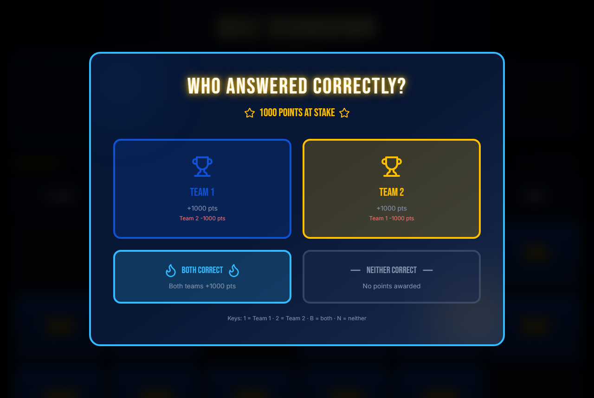</a><br><strong>6 · Scoring</strong><br><sub>Team 1, Team 2, both, or neither</sub></td>
  </tr>
  <tr>
    <td align="center"><a href="docs/screenshots/06-round-result.png">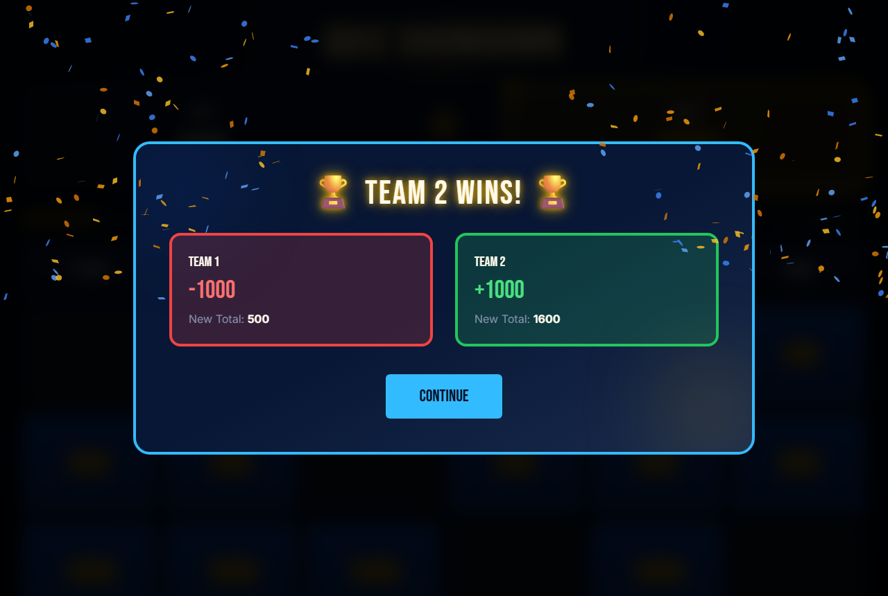</a><br><strong>7 · Round result</strong><br><sub>Point swing and new totals</sub></td>
    <td align="center"><a href="docs/screenshots/07-game-complete.png">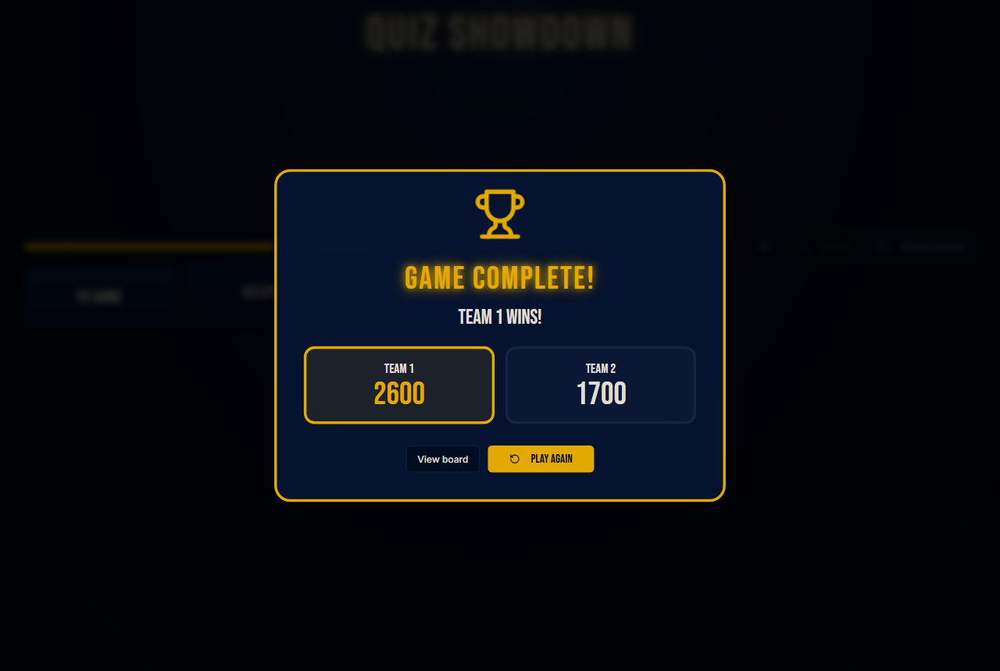</a><br><strong>8 · Game complete</strong><br><sub>Winner and final scores</sub></td>
    <td align="center"><a href="docs/screenshots/08-phone.png">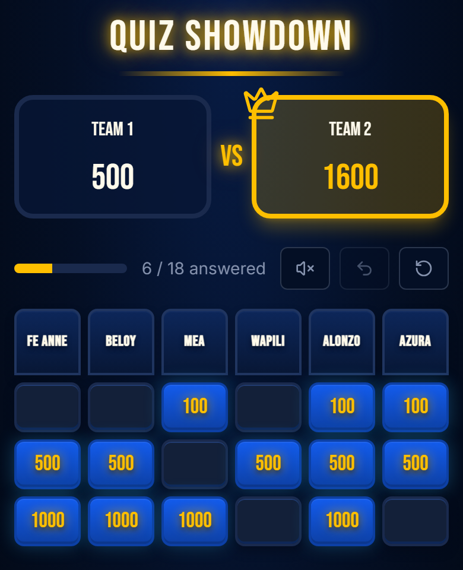</a><br><strong>9 · Phone</strong><br><sub>The whole board fits a phone screen</sub></td>
  </tr>
</table>

## How it works

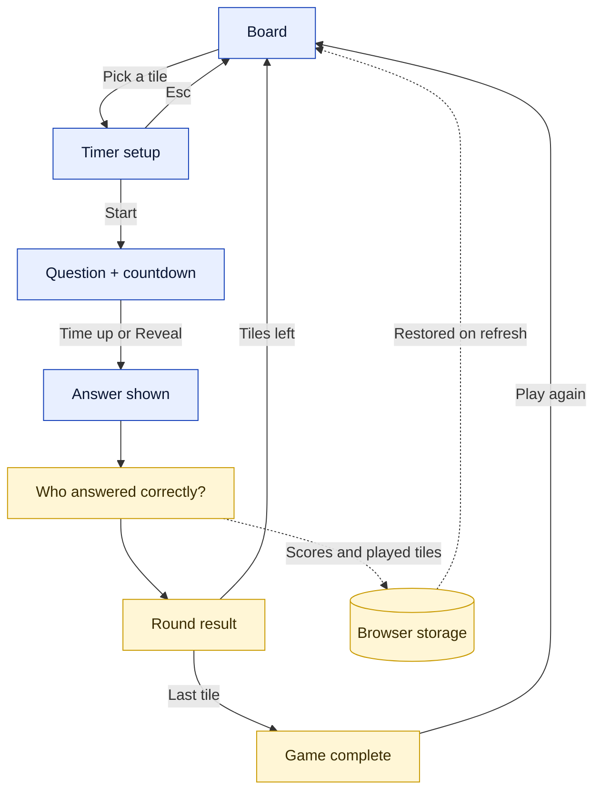

Each scored question is saved to the browser's `localStorage` along with the team names, timer length, and an undo history of the last 50 rounds. **Undo** restores the scores and board exactly as they were before the last scoring. **Reset Game** clears scores and tiles but keeps team names. The mute setting is saved separately.

## Run it locally

You need [Node.js](https://nodejs.org/) 18 or newer.

```sh
npm install
npm run dev
```

The game opens in your browser at <http://localhost:8080>. If port 8080 is taken, Vite picks the next free port and prints it in the terminal.

To build a production copy and serve it locally:

```sh
npm run build
npm run preview
```

The production copy runs at <http://localhost:4173>. The built files in `dist/` are plain static files, so any static web server can host them.

> The display fonts load from Google Fonts. Without internet access the game still works but falls back to a system font.

## Explore the repository

| Area | Start here | What you will find |
| --- | --- | --- |
| Questions | [src/data/gameData.ts](src/data/gameData.ts) | Categories, questions, answers, and point values |
| Game flow | [src/components/JeopardyGame.tsx](src/components/JeopardyGame.tsx) | Phases, scoring rules, autosave, undo, and reset |
| Screens | [src/components/](src/components/) | Board, timer setup, question, scoring, and scoreboard |
| Sound | [src/hooks/useSoundEffects.ts](src/hooks/useSoundEffects.ts) | Generated sound effects and the mute setting |
| Theme | [src/index.css](src/index.css) · [tailwind.config.ts](tailwind.config.ts) | Stage colors, tile styles, and glow effects |
| Screenshots | [docs/screenshots/](docs/screenshots/) | The images used in this README |

## Hosting the game

1. Open the game on the laptop that's connected to the projector. Use full screen (`F11`) so the board fills the screen.
2. Click **Team 1** and **Team 2** on the scoreboard to type the team names.
3. Pick a tile. Choose a time limit (20 s is the default and is remembered), then press **Start** or `Enter`.
4. Read the question aloud. Pause with `Space` if there's a dispute, or press `+` for 10 more seconds.
5. When time runs out the answer appears by itself. To show it early, press **Reveal Answer** or `Enter`.
6. Press `Enter` again (or **Score it**) and choose who got it right:
   - **Team 1 / Team 2:** that team gains the points and the other team **loses** the same amount.
   - **Both correct:** both teams gain the points.
   - **Neither correct:** no change.
7. Press `Enter` to go back to the board. Scored the wrong team? Press **Undo**.

### Keyboard shortcuts

| Screen | Keys |
| --- | --- |
| Timer setup | `Enter` start · `Esc` back to the board |
| Question | `Space` pause or resume · `+` add 10 seconds · `Enter` reveal the answer, then go to scoring |
| Scoring | `1` Team 1 · `2` Team 2 · `B` both · `N` neither · `Enter` continue |

The speaker button next to **Undo** mutes or unmutes all sounds.

## Edit the questions

All categories, questions, and answers are in [`src/data/gameData.ts`](src/data/gameData.ts). Each question looks like this:

```ts
{
  id: "cat-1-q-0",
  question: "This is a method of criticism of art that focuses on the visuals or structural aspects of a work of art to reach a conclusion.",
  answer: "Formalism",
  value: 100,
  categoryId: "cat-1",
  answered: false,
},
```

- Give every category one question for each value in `POINT_VALUES` (`[100, 500, 1000]`). To change the values or add a row, edit that list and add a matching question to each category.
- Keep each `id` unique. Saved progress is matched by `id`, so after a big change, press **Reset Game** to start clean.
- The board resizes itself to however many categories you add or remove.

## Scripts

| Command | What it does |
| --- | --- |
| `npm run dev` | Start the dev server with hot reload at <http://localhost:8080> |
| `npm run build` | Build the production copy into `dist/` |
| `npm run preview` | Serve `dist/` locally at <http://localhost:4173> |
| `npm run lint` | Run ESLint |
| `npm test` | Run the tests with Vitest |

## Notes

- Progress is stored per browser and per address. Opening the game in another browser, or at a different port, starts a fresh board.
- Clearing the browser's site data erases the saved game.
- Most browsers block sound until the first click, so the opening tile click is what turns on the sound effects.
